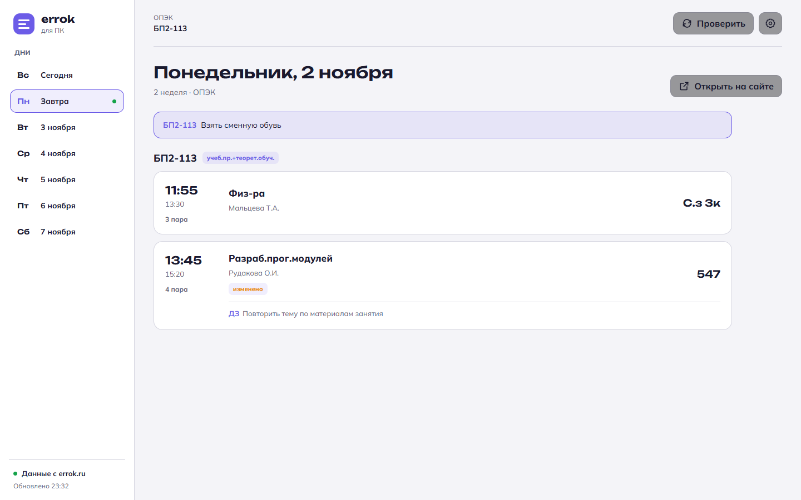

# errok для ПК

[](https://github.com/Loadtrack/errok-pc/actions/workflows/windows.yml)

Настольное приложение для Windows с расписанием ОПЭК и ОмАЭиП. Показывает пары выбранных групп и преподавателей, учитывает правки с [errok.ru](https://errok.ru) и сообщает об изменениях.



## Возможности

- Расписание выбранных групп и преподавателей: время, дисциплина, аудитория и подгруппа.
- Уведомления Windows о новых днях и изменениях в парах.
- Дополнительные пары, объявления, домашние задания и пометки об изменениях.
- Последнее загруженное расписание доступно без интернета.
- Светлая, тёмная и системная темы.
- Сворачивание в трей и автозапуск вместе с Windows.

## Скачать и установить

**[Скачать errok для ПК v0.1.0 для Windows](https://github.com/Loadtrack/errok-pc/releases/download/v0.1.0/errok%20%D0%B4%D0%BB%D1%8F%20%D0%9F%D0%9A_0.1.0_x64-setup.exe)**

1. Скачайте и запустите установщик.
2. При первом запуске выберите колледж и нужные группы или преподавателей.

Установка выполняется только для текущего пользователя, права администратора не нужны. Приложение пока не подписано кодовым сертификатом, поэтому Windows SmartScreen может показать предупреждение.

## Данные и приватность

В приложении нет рекламы, аналитики, телеметрии и входа в аккаунт. Настройки и кэш расписания хранятся локально. На errok.ru отправляются только запрошенные даты, выбранные группы и преподаватели.

## Сборка из исходников

Для локальной сборки нужны Node.js, Rust и Microsoft C++ Build Tools.

```bash
npm ci
npm run tauri build
```

Готовый установщик появится в `src-tauri/target/release/bundle/nsis/`.

Проверки проекта:

```bash
npm run build
npm run test:ui
cargo test --manifest-path src-tauri/Cargo.toml
```

Интерфейс написан на TypeScript, нативная часть — на Rust с использованием Tauri 2. Тесты используют сохранённые ответы API обоих колледжей.
